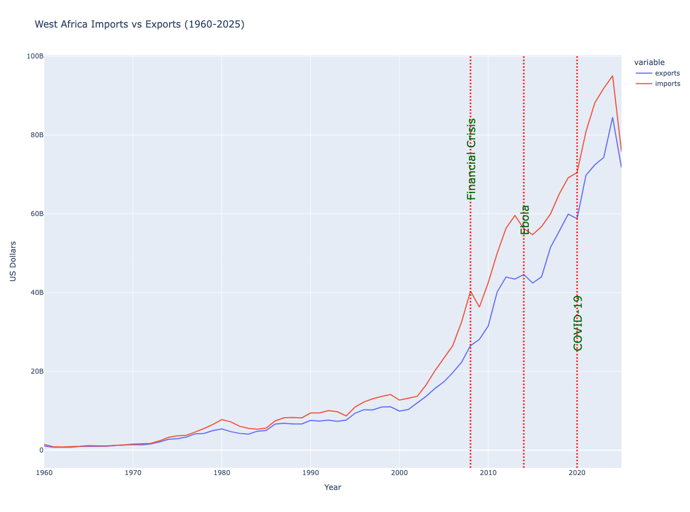
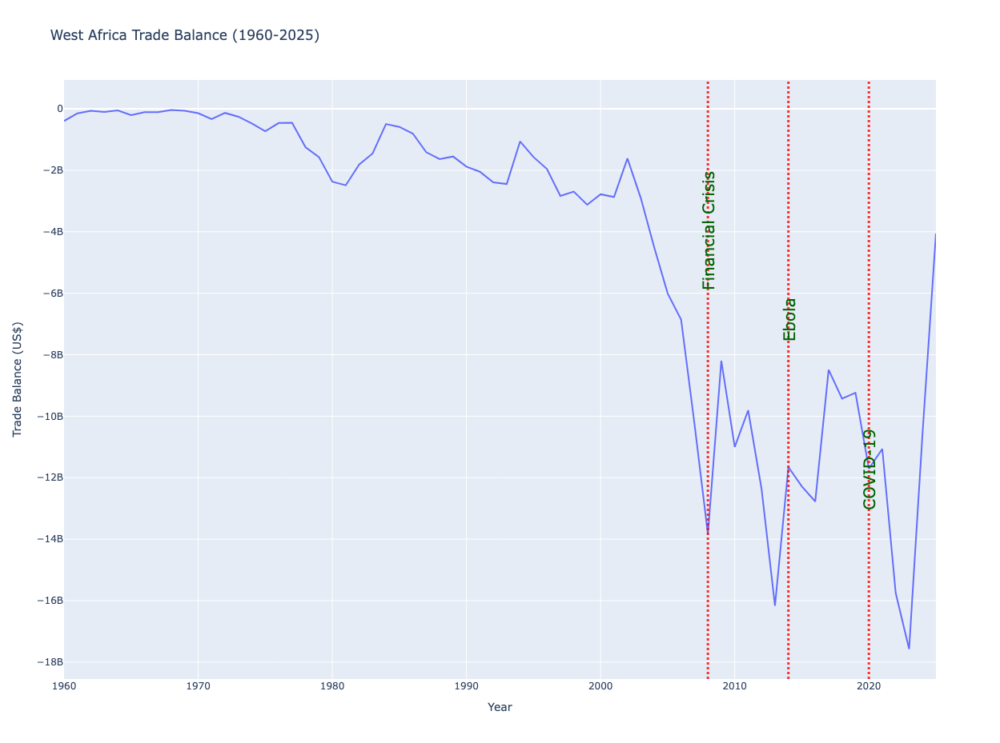
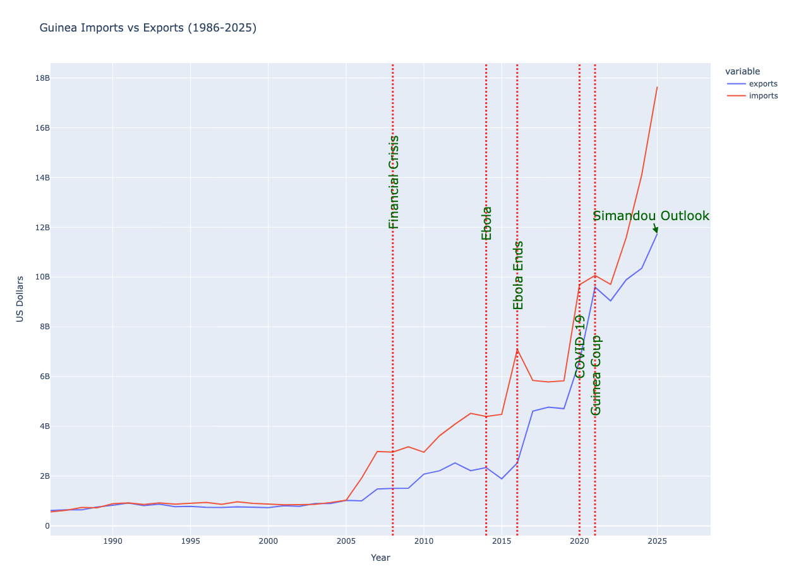
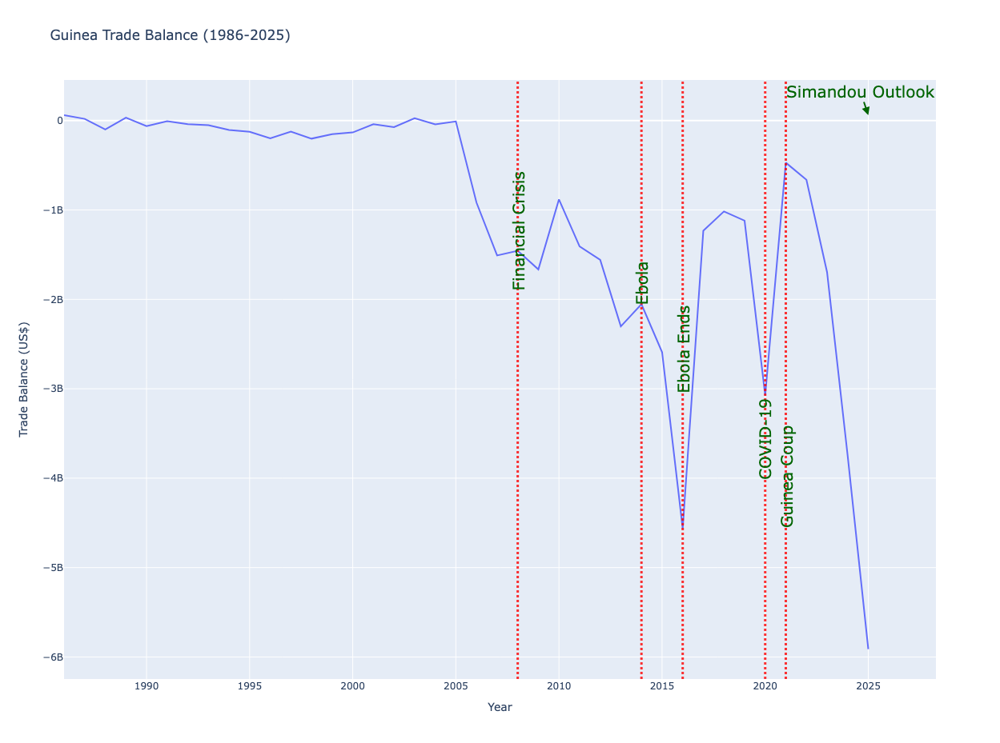
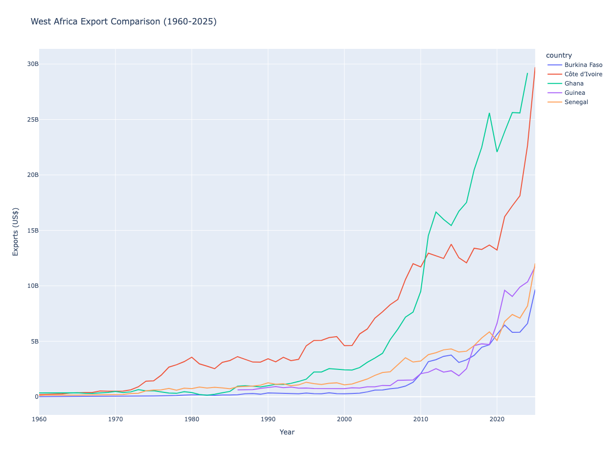

# West Africa Trade Analytics (1960-2025)

## Overview

West Africa Trade Analytics (1960-2025) is a data analytics project that explores trade performance across selected West African economies over a 65-year period.

The project analyzes imports, exports, and trade balances to identify long-term economic trends and evaluate the impact of major economic, health, and political events.

A special focus is given to Guinea, examining the evolution of its trade performance and the potential future impact of the Simandou iron ore project.

---

## Objectives

This project aims to:

- Analyze import and export trends in West Africa.
- Compare trade performance across countries.
- Evaluate regional trade balances over time.
- Assess the impact of major global and regional events.
- Explore Guinea's trade dynamics.
- Discuss the future implications of the Simandou project.

---

## Countries Included

- Burkina Faso
- Côte d'Ivoire
- Ghana
- Guinea
- Guinea-Bissau
- Mali
- Senegal
- Sierra Leone

> Note: Data availability varies by country depending on source coverage.

---

## Business Questions

### Regional Analysis

1. Which West African countries export the most?
2. Which countries import the most?
3. How has trade evolved between 1960 and 2025?
4. How have major crises affected regional trade performance?
5. Which countries show stronger export growth over time?

### Guinea Case Study

1. How have Guinea's imports and exports evolved since 1986?
2. What was the impact of the 2008 Global Financial Crisis?
3. What was the impact of the Ebola outbreak (2014-2016)?
4. How did COVID-19 affect trade activity?
5. What was the effect of the 2021 military coup?
6. How does Guinea compare with leading West African exporters?
7. What role has the mining sector played in export growth?
8. What could be the future impact of the Simandou project?

---

## Major Events Analyzed

| Year | Event |
|------|--------|
| 2008 | Global Financial Crisis |
| 2014 | Ebola Outbreak |
| 2016 | End of Ebola Crisis |
| 2020 | COVID-19 Pandemic |
| 2021 | Guinea Military Coup |

---

## Dataset

### Source

World Bank Data360

### Indicators

- Imports of Goods and Services (current US$)
- Exports of Goods and Services (current US$)

### Coverage

1960-2025

---

## Methodology

### Data Preparation

- Extract raw trade data
- Filter selected West African countries
- Create processed datasets
- Calculate trade balances

### Formula

```text
Trade Balance = Exports - Imports
```

### Tools Used

- Python
- Pandas
- Plotly
- SQLite
- Git
- GitHub

---

## Project Structure

```text
west-africa-trade-analytics
│
├── assets
├── data
│   ├── raw
│   └── processed
│
├── src
│   ├── analysis.py
│   ├── create_trade_balance.py
│   ├── extract.py
│   ├── filter_west_africa.py
│   ├── load.py
│   └── transform.py
│
├── visualizations
│   ├── west_africa_trade_overview.html
│   ├── trade_balance.html
│   ├── guinea_trade_analysis.html
│   ├── guinea_trade_balance.html
│   └── west_africa_comparison.html
│
└── README.md
```

---

## Visualizations

### West Africa Imports vs Exports (1960-2025)



---

### West Africa Trade Balance (1960-2025)



---

### Guinea Imports vs Exports (1986-2025)



---

### Guinea Trade Balance (1986-2025)



---

### West Africa Export Comparison (1960-2025)



---

## Key Findings

- Regional trade expanded significantly after the early 2000s.
- Ghana and Côte d'Ivoire emerged as major exporting economies within the analyzed dataset.
- Guinea experienced strong growth in trade activity after the late 2000s.
- Ebola, COVID-19, and political instability coincided with visible disruptions in trade trends.
- Guinea's trade balance remains an importantormance.

---

## Future Outlook: Simandou Project

One of the most important questions for Guinea's economic future is the impact of the Simandou iron ore project.

Simandou has the potential to:

- Increase export revenues.
- Diversify Guinea's mining exports.
- Improve transportation infrastructure.
- Strengthen regional trade competitiveness.
- Support long-term economic growth.

Historical trade data suggests that mining has already played a significant role in Guinea's export growth. The Simandou project could represent the next major phase of trade expansion.

**Could Simandou transform Guinea into one of West Africa's leading exporting economies?**

---

## Author

**Alpha Diallo**

Data Analytics & Data Engineering Portfolio Project